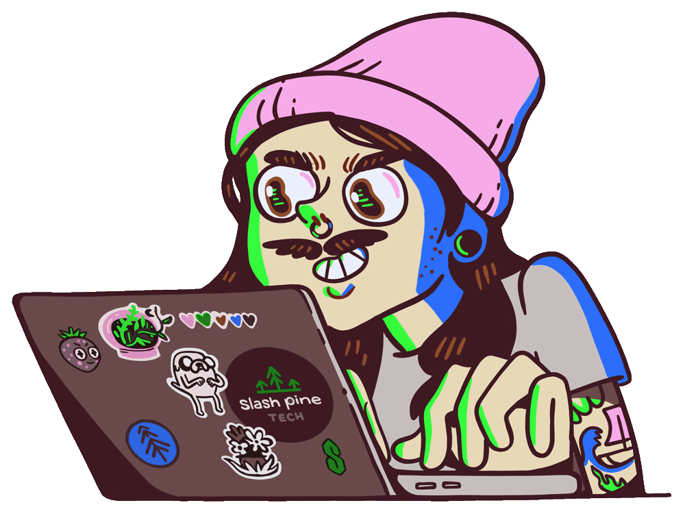

 

  

  

<!-- GitHub Streak Stats -->
<picture>
  <source
    media="(prefers-color-scheme: dark)"
    srcset="https://github-readme-streak-stats-eight.vercel.app/?user=Mahi-rejone&hide_border=true&background=0A101F&stroke=22D3EE&ring=A78BFA&fire=10B981&currStreakLabel=22D3EE&sideLabels=94A3B8&currStreakNum=F8FAFC&sideNums=F8FAFC&dates=64748B&titleColor=22D3EE&card_width=1180"
  />
  <source
    media="(prefers-color-scheme: light)"
    srcset="https://github-readme-streak-stats-eight.vercel.app/?user=Mahi-rejone&hide_border=true&background=FFFFFF&stroke=7C3AED&ring=7C3AED&fire=10B981&currStreakLabel=0F172A&sideLabels=475569&currStreakNum=0F172A&sideNums=0F172A&dates=64748B&titleColor=0F172A&card_width=1180"
  />
  
</picture>

<!-- GitHub Stats -->
<picture>
  <source
    media="(prefers-color-scheme: dark)"
    srcset="https://github-readme-stats-pi-eosin-21.vercel.app/api?username=Mahi-rejone&show_icons=true&count_private=true&include_all_commits=true&hide_rank=true&hide_border=true&title_color=22D3EE&icon_color=A78BFA&text_color=94A3B8&bg_color=0A101F&card_width=500"
  />
  <source
    media="(prefers-color-scheme: light)"
    srcset="https://github-readme-stats-pi-eosin-21.vercel.app/api?username=Mahi-rejone&show_icons=true&count_private=true&include_all_commits=true&hide_rank=true&hide_border=true&title_color=0F172A&icon_color=7C3AED&text_color=475569&bg_color=FFFFFF&card_width=500"
  />
  
</picture>

<!-- Top Languages -->
<picture>
  <source
    media="(prefers-color-scheme: dark)"
    srcset="https://github-readme-stats-pi-eosin-21.vercel.app/api/top-langs/?username=Mahi-rejone&layout=compact&langs_count=8&hide_border=true&title_color=22D3EE&text_color=94A3B8&bg_color=0A101F&card_width=500"
  />
  <source
    media="(prefers-color-scheme: light)"
    srcset="https://github-readme-stats-pi-eosin-21.vercel.app/api/top-langs/?username=Mahi-rejone&layout=compact&langs_count=8&hide_border=true&title_color=0F172A&text_color=475569&bg_color=FFFFFF&card_width=500"
  />
  
</picture>

 

  
  &nbsp;
  
  &nbsp;
  

---

## 👨‍💻 About Me

I'm a **full-stack web developer** and CSE student at **Uttara University**, based in Bangladesh, building web apps from database to UI.

- 🎓 Studying: **Computer Science & Engineering / Uttara University**
- 💻 Experienced with **C, C#, Java, and JavaScript**, and growing my skills in **Python**
- 🩸 Built **BloodFlow**, a full-stack blood donation management platform
- 🌱 Currently learning: **AI Engineering**
- 🎯 Looking for opportunities to grow, collaborate, and build real-world products

 

---

## 🛠️ Tech Stack

### Languages

  

### Frontend

  

### Backend & Databases

  

### Tools

  

<!--
# 💻 Additional Tech Stack

-->

---

## 🚀 Featured Projects

### 🩸 BloodFlow: Blood Donation Management Platform

A full-stack platform that connects donors, blood banks, and hospitals, with OTP-verified donations and role-based dashboards.

| | |
| --- | --- |
| **Frontend** | Next.js (App Router), Redux Toolkit + RTK Query, Tailwind CSS, shadcn/ui, Ant Design |
| **Backend** | Express, Prisma, PostgreSQL (Neon), JWT auth with refresh tokens |
| **Highlights** | OTP-based donation verification, four user roles (admin, blood bank manager, hospital rep, user), notification system with Cron jobs, email via Resend |
| **Deployment** | Vercel, custom domain via Cloudflare |
| **Links** | Add your actual repository and live demo URLs |

<!-- Add your BloodFlow screenshot here -->
<!--  -->

<!--
### 🚀 Project 2

Add your project description here.

| | |
| --- | --- |
| **Tech** | Add your tech stack |
| **Highlights** | Add your key features |
| **Links** | Add repository and live demo URLs |

### 🚀 Project 3

Add your project description here.

| | |
| --- | --- |
| **Tech** | Add your tech stack |
| **Highlights** | Add your key features |
| **Links** | Add repository and live demo URLs |
-->

---

## 🔝 Top Repositories

---

  

